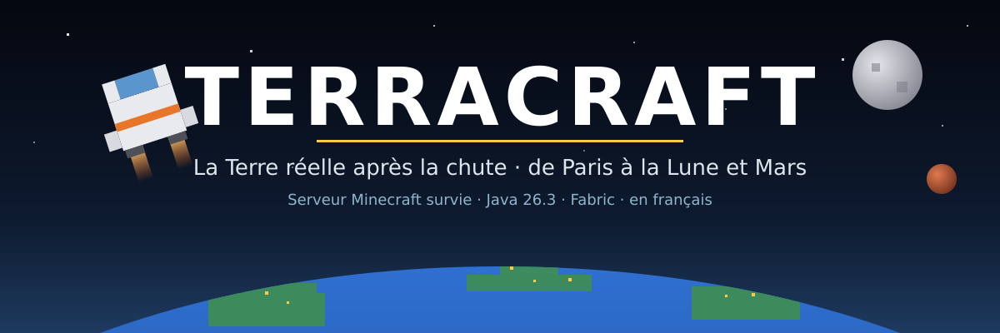

  

  
  
  
  
  

<h3 align="center">🌍 Adresse du serveur : <code>terre1.falixsrv.me</code></h3>

  <a href="https://github.com/propann/TerraCraft/releases/latest/download/TerraCraft-client.mrpack"><b>⬇ Télécharger le pack client</b></a>
  &nbsp;·&nbsp; <a href="REJOINDRE.md">Guide pour rejoindre</a>
  &nbsp;·&nbsp; <a href="docs/feuille-de-route.md">Feuille de route</a>
  &nbsp;·&nbsp; <a href="https://github.com/propann/TerraCraft/releases">Nouveautés</a>

---

L'humanité a disparu. Il reste **la vraie planète** : tes rues, ta ville, ses immeubles, ses gares et ses hôpitaux,
reconstruits bloc par bloc d'après OpenStreetMap, le relief réel et la météo du moment. Tu choisis ton point de
départ sur une carte du monde, tu fouilles les ruines, tu montes une ville avec tes amis, tu remets en marche une
raffinerie… puis tu construis ton vaisseau et tu pars pour l'orbite, la Lune et Mars.

> **1 bloc = 1 mètre à Paris.** Une seule carte continue pour toute la planète : celui qui part d'Espagne et celui
> qui part d'Allemagne peuvent se retrouver en France, sur les mêmes routes.

## ✨ Ce qui t'attend

| | |
|---|---|
| 🗺️ **La Terre réelle** | Relief, climats, routes, rivières et bâtiments réels ; étages de 4 blocs, îlots haussmanniens avec cour intérieure, tours de La Défense ; météo en direct. Hôpitaux, pharmacies, gares, commissariats avec un butin à leur image (`/lieux`). |
| ☢️ **Un monde après la chute** | Ruines, bunkers gardés par un commandant, convois militaires en panne, zones contaminées, vagues nocturnes sur les villes, ravitaillements largués. |
| 🏛️ **Villes et politique** | Fonde ta ville, recrute, gère la trésorerie et le stock commun. Le maire est **élu** : élection tous les 14 jours, motion de défiance, registre de la mairie. |
| 💰 **Économie entre joueurs** | Hôtel des ventes, étals de marché qui vendent même quand tu dors, contrats du jour, métiers et réputation, primes. |
| 🚗 **Véhicules** | Voiture, camion, moto, avion piloté au clavier, jetpack, rover lunaire : on les assemble pièce par pièce et on fait le plein. |
| 🏭 **Industrie** | Pétrole, pompes, raffinerie, panneaux solaires, batteries, groupe électrogène, serre hydroponique, réseaux de tuyaux et de câbles. |
| 🚀 **L'espace** | Station orbitale, Lune et ses sanctuaires extraterrestres, Mars, ceinture d'astéroïdes, carte des étoiles, combinaison et oxygène. |
| 🛸 **Ton vaisseau, en blocs** | Construis la coque que tu veux (pentes, verrières, réacteurs, réservoirs, sas), assieds-toi aux commandes : ton vaisseau décolle **tel que tu l'as bâti**, coffres compris, et s'amarre **sas contre sas** à ta station. |
| 📖 **Tout est expliqué** | Menu `O`, catalogue des objets avec leurs recettes, parcours « Premiers pas », aide par thèmes, tout en français. |

## 🎮 Rejoindre en 2 minutes

1. Installe **[Prism Launcher](https://prismlauncher.org/)** (gratuit) ou **Modrinth App**, connecte ton compte Microsoft.
2. Télécharge **[TerraCraft-client.mrpack](https://github.com/propann/TerraCraft/releases/latest/download/TerraCraft-client.mrpack)**.
3. *Ajouter une instance → Importer* → choisis le fichier.
4. Lance l'instance → **Multijoueur** : **TerraCraft** (`terre1.falixsrv.me`) est déjà dans la liste.

Le pack installe Fabric, les mods et les cartes Xaero. Autres méthodes (launcher officiel, installation à la main) :
**[REJOINDRE.md](REJOINDRE.md)** et le dossier **[`mods/`](mods/LISEZMOI.md)**, toujours aligné sur la dernière version.

**Une fois en jeu :** choisis ta ville sur la carte du monde · `O` menu et catalogue · `J` combinaison spatiale ·
`/aide` pour tout le reste · `/signaler` si quelque chose cloche.

## 📜 Règles

1. Respect : pas d'insultes, de harcèlement ni de propos haineux.
2. PvE partout : on ne combat d'autres joueurs que dans les zones PvP (`/pvp`).
3. Pas de vol ni de destruction sur le terrain d'autrui ; protège le tien avec les claims (touche `M`).
4. Pas de triche : clients modifiés, X-ray, exploitation de bugs ou duplication. Un bug ? `/signaler`.
5. Pas de constructions offensantes, ni de lag volontaire (machines géantes, spam d'entités).
6. Les décisions des modérateurs s'appliquent ; contestation calme via `/signaler`.

Les mêmes règles s'affichent en jeu à la première connexion et avec `/regles`.

## 🛰️ Où en est le projet

**Version 0.38** : nouveau monde à l'échelle de Paris, vaisseaux construits, catalogue, élection du maire.
Chaque version passe une batterie de tests avant d'arriver sur le serveur :

- **92 vérifications** jouées par de faux joueurs sur un vrai serveur (villes, économie, combats, industrie, vols
  jusqu'à la Lune, vaisseau amarré, élection) ;
- contrôle de **chaque objet** (traductions, textures, description, recette valide) ;
- mesures de génération sur des lieux réels (Paris, La Défense, Berlin, la frontière franco-espagnole…).

**Prochaines étapes** : bâtiments encore plus fidèles, lois municipales votées, vaisseaux qui pivotent en vol,
et peut-être des habitants qui parlent grâce à une IA française. Le détail : **[feuille de route](docs/feuille-de-route.md)**.

## ⭐ Suivre l'aventure

- **Star** ⭐ le dépôt pour nous soutenir, **Watch → Releases** pour être prévenu de chaque nouvelle version.
- Les nouveautés de chaque version s'affichent aussi en jeu, à la connexion.
- Une idée, un bug ? `/signaler` en jeu, ou une [issue](https://github.com/propann/TerraCraft/issues).

## 📚 Documentation

| Document | Contenu |
|---|---|
| [`REJOINDRE.md`](REJOINDRE.md) | Rejoindre le serveur : pack, installeurs, installation à la main |
| [`docs/commandes.md`](docs/commandes.md) | Toutes les touches et commandes (joueurs et administrateurs), journaux, fichiers de données |
| [`docs/feuille-de-route.md`](docs/feuille-de-route.md) | Plan d'action, phases, ce qui est fait et la suite |
| [`docs/etat-du-projet.md`](docs/etat-du-projet.md) | Analyse : ce que nous avons, niveau de vérification, risques |
| [`docs/avancement.md`](docs/avancement.md) | Liste de contrôle de la version en cours et tests restants |
| [`docs/entree-en-jeu.md`](docs/entree-en-jeu.md) | Parcours d'un joueur, de la liste des serveurs aux premiers pas |
| [`docs/architecture-systeme-solaire.md`](docs/architecture-systeme-solaire.md) | Espace : destinations, carburant, stations, plans |
| [`docs/localisation-et-monde.md`](docs/localisation-et-monde.md) | Génération de la Terre réelle |
| [`docs/mesures-generation.md`](docs/mesures-generation.md) | Mesures de performance de la génération |\n| [`docs/plan-route-batiments-generation-2.md`](docs/plan-route-batiments-generation-2.md) | Plan de travail pour améliorer le rendu des bâtiments, essais locaux et passage éventuel vers `map` |
| [`deploy/FALIX.md`](deploy/FALIX.md) | Hébergement Falix, sauvegardes, restauration, nouveau monde |

## 🛠️ Développement

| Dossier | Contenu |
|---|---|
| `geo-mod/` | Le mod Fabric `terracraft-geo` (serveur + client) |
| `mods/` | Mods du client, alignés sur la dernière version (les cartes Xaero se téléchargent par script) |
| `serveur-local/` | Serveur de test local (`start-fabric.sh`) |
| `tools/` | Mods tiers figés (`mods.lock.json`), pack client, textures, contrôles, test de scénario, mesures |
| `deploy/` | Déploiement Falix |
| `installer/` | Installeurs joueurs |
| `docs/`, `etude/` | Décisions, architecture, feuille de route, étude des serveurs existants |

Compiler et installer en local : `geo-mod/build-mod.sh` (avec `CLIENT_MODS_DIR=…` pour une instance client).

### Publier une version

1. Monter `mod_version` dans `geo-mod/gradle.properties`.
2. Tester : `tools/check_assets.py` (ressources, descriptions, catégories), `tools/check_recipes.py` (recettes),
   `tools/scenario_test.sh <jar>` (92 vérifications avec trois faux joueurs Carpet), `tools/geo_bench.sh`
   (génération) ; `tools/ping_server.py` montre ce que voit la liste des serveurs.
3. Pousser sur `main` : la CI contrôle, compile, **démarre un vrai serveur** (`tools/smoke_server.sh`) puis met à jour
   la branche **`falix`** (copiée par Falix à la racine du serveur ; redémarrer le serveur ensuite).
4. Si le client change (objets, écrans, réseau), pousser un tag `vX.Y.Z` : la CI publie une release avec le jar et
   `TerraCraft-client.mrpack`. Puis `python3 tools/sync_client_mods.py` réaligne `mods/` et le pack du dépôt.

Mods tiers : versions figées dans `tools/mods.lock.json`, identiques sur le serveur et dans le pack.
Pour les mettre à jour : `python3 tools/install_mods.py --update-lock`, tester, puis commiter.

Données cartographiques © contributeurs <a href="https://www.openstreetmap.org/copyright">OpenStreetMap</a> (ODbL), tuiles <a href="https://openfreemap.org">OpenFreeMap</a>, relief AWS Terrain Tiles, météo <a href="https://open-meteo.com">Open-Meteo</a>. Minecraft est une marque de Mojang ; projet non officiel.

